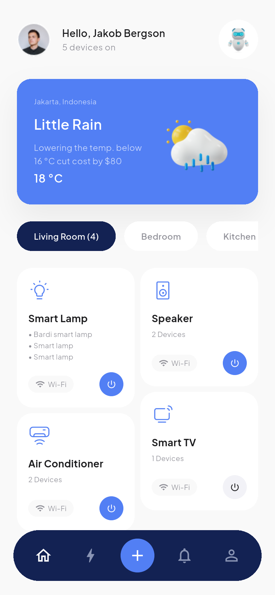
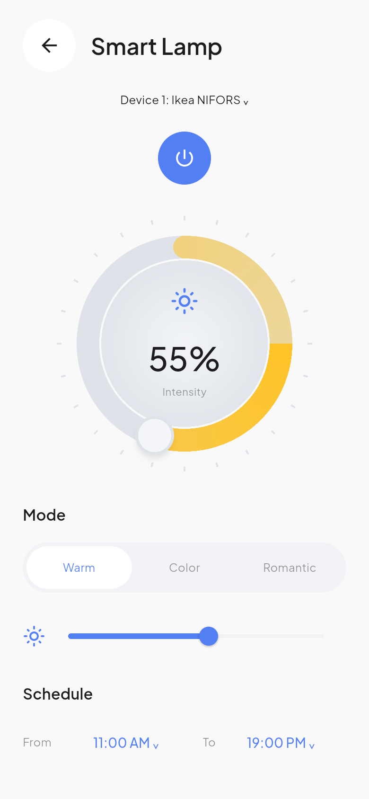
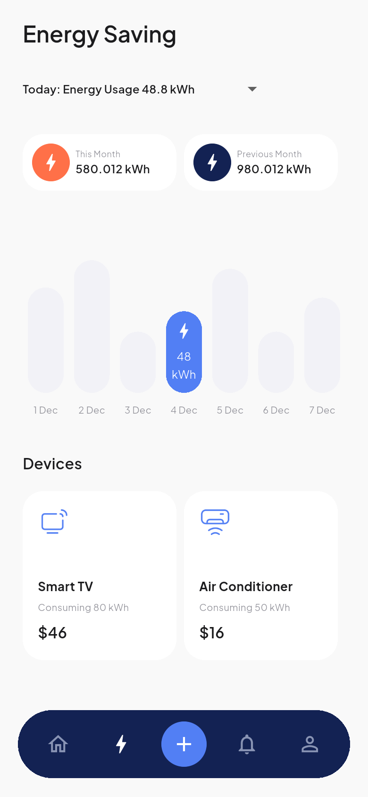
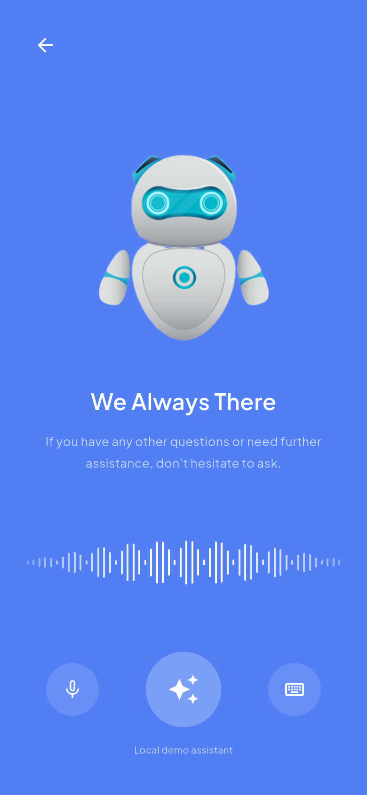
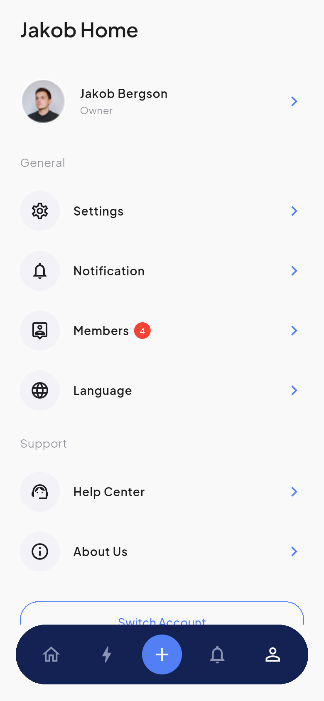
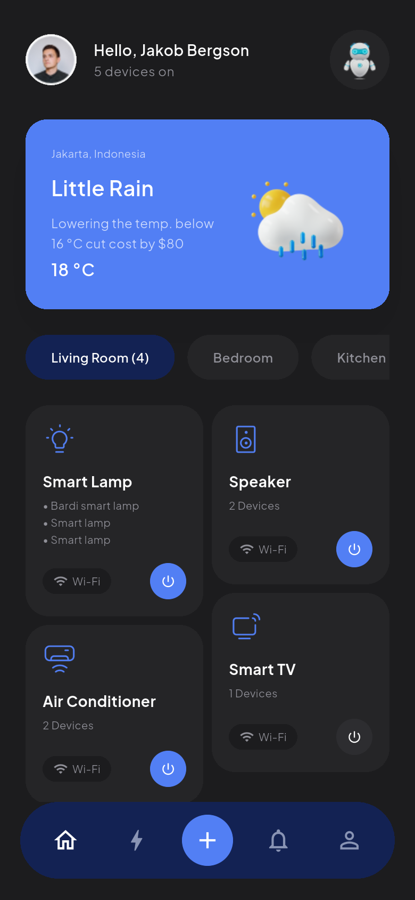

# SuperSemart 智能家居 Flutter App

根据 Pixso 文件 **SuperSemart - Smarthome Apps UI Kits** 开发的可交互 Flutter 应用。设计通过 Pixso MCP 读取，覆盖账号引导、家庭/房间配置、设备控制、能耗、通知、助手和个人中心，提供浅色/深色主题。

## 主要界面

以下是实际 Flutter 运行截图，设计原稿另外保存在 `docs/design/`。

| 家庭设备首页 | 灯光控制 | 能耗统计 |
| --- | --- | --- |
|  |  |  |

| 智能助手 | 个人中心 | 深色首页 |
| --- | --- | --- |
|  |  |  |

完整页面与截图见 [界面索引](docs/SCREENS.md)，项目分层、数据流及扩展方式见 [架构说明](docs/ARCHITECTURE.md)。

## 已实现

- **引导与账号**：欢迎页、注册/登录表单、邮箱校验、忘记密码、演示验证码、重置密码及条款弹窗。
- **家庭与房间**：家庭信息编辑、房间选择、新建/改名房间、管理页、家庭切换弹窗。
- **设备控制**：按房间筛选、独立设备开关、灯光亮度/模式/时段、空调温度/模式/定时/场景/摆风。
- **设备添加**：选择房间 → 发现设备 → 连接 → 成功反馈 → 查看设备。重复连接不会在同一房间重复添加。
- **能耗与通知**：月份比较、日期柱状图交互、设备能耗卡片、常规/厨房通知及邀请接受/拒绝。
- **助手与支持**：机器人欢迎页、聊天输入/发送/滚动、按问题给出演示回复、FAQ 搜索/展开。
- **个人与设置**：资料更新、成员添加、语言偏好选择、深色主题、通知偏好、退出确认。
- **本地保存**：设备状态、房间、资料、控制参数及偏好使用 SharedPreferences 保存。

## 运行

需要 Flutter 3.47.7 / Dart 3.13.5 或兼容版本，以及已安装的 Android SDK。优先使用现有设备。

```powershell
flutter pub get
flutter devices
flutter run -d emulator-5554
```

首次进入欢迎页可点 **Explore demo** 直接体验。注册/登录表单为本地演示，任意有效格式邮箱及至少 8 位密码即可继续，不会向服务器发送凭据。演示验证码为 **1234**；重置密码要求包含字母和数字。

深色主题入口：**Profile → Settings → Dark Mode**。

## 工程结构

```text
lib/
├── main.dart                    # 初始化本地状态
├── app.dart                     # 统一路由表、主题、应用入口
├── core/
│   ├── home_store.dart          # 设备模型、业务状态、本地存储
│   ├── theme.dart               # 从设计稿提取的颜色、排版、控件风格
│   └── widgets.dart             # 页面骨架、底栏、卡片、输入框、房间弹窗
└── features/
    ├── onboarding.dart          # 引导、账号、验证码、条款
    ├── setup.dart               # 家庭、房间、模拟配对流程
    ├── dashboard.dart           # 首页、能耗统计
    ├── device_control.dart      # 灯、空调、通用设备、环形控制盘
    ├── notifications.dart       # 通知、邀请
    ├── assistant.dart           # 机器人欢迎、聊天
    └── profile.dart             # 设置、成员、语言、帮助、关于
assets/
├── fonts/                       # Plus Jakarta Sans 及 OFL 授权
└── images/                      # Pixso 导出的原始视觉素材与图标
test/                            # 本地状态与存储逻辑测试
integration_test/                # 132 组布局检查、流程验证及 39×2 截图
test_driver/                     # 截图落盘
docs/
├── ARCHITECTURE.md              # 架构与扩展说明
├── SCREENS.md                   # 原稿与实现的页面映射
├── VALIDATION.md                # 测试环境、结果与已知边界
├── design/                      # Pixso 原稿参考、节点信息
└── screenshots/{light,dark}/    # Flutter 运行截图
```

## 验证与截图复现

```powershell
flutter analyze
flutter test
flutter drive -d emulator-5554 --driver=test_driver/screenshots.dart --target=integration_test/app_tour_test.dart
```

截图脚本遍历所有设计页面/状态，并验证设备控制、模拟配对及数据重载。截图保存在 `docs/screenshots/`。脚本使用已存在的 Android 模拟器，不创建新的 AVD，也不下载新的系统镜像。

## 当前边界

这是基于设计稿的 **本地交互演示**。账号登录、密码找回、OAuth、设备发现、天气、能耗、推送通知、语音、照片上传和聊天回复未接入真实外部服务。语言页保存语言偏好，界面文字仍遵循原稿英文。家庭切换目前更改当前家庭名称，未实现独立家庭的云端数据隔离。

Android 已作为本次主要验证平台；iOS 工程已提供，但在 Windows 环境无法完成 Xcode 编译和签名。Android 发布签名仍需配置正式 keystore。

工程只引入一个运行时第三方依赖 `shared_preferences`；未引入大型路由、状态管理或图表库。图表和控制盘均使用 Flutter 原生绘制。

## 设计来源与字体

- Pixso 文档：SuperSemart - Smarthome Apps UI Kits。
- 原文档分类：Thumbnail、Style Guide、UI Design；UI Design 包含浅色/深色两组，39 个页面/状态每组。
- 设计节点与文案：`docs/design/manifest.json`。
- 字体：Plus Jakarta Sans，SIL Open Font License，授权见 `assets/fonts/OFL.txt`。

