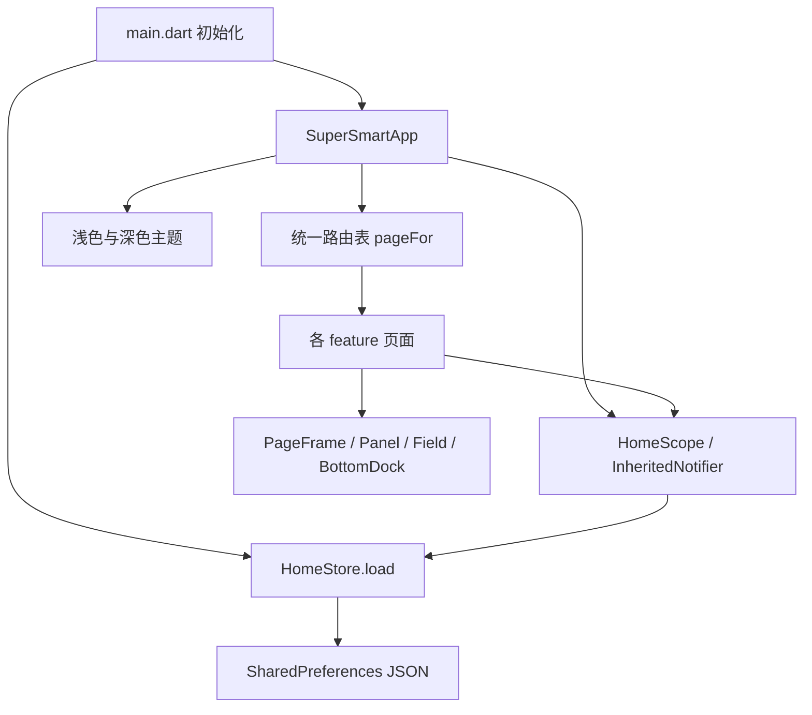

# 项目结构与架构说明

## 分层原则

项目采用轻量的“界面 → 状态仓库 → 本地存储”分层，按功能组织页面。`HomeStore` 是唯一共享业务状态来源，`HomeScope` 向页面提供状态，`ChangeNotifier` 驱动刷新。页面自己的搜索词、展开项和聊天输入等临时状态保留在各自的 StatefulWidget 中。

## 代码职责

| 文件 | 职责 |
| --- | --- |
| `lib/main.dart` | 初始化 Flutter、读取本地数据、启动应用 |
| `lib/app.dart` | 统一路由、主题切换、可注入 NavigatorKey，便于集成测试 |
| `lib/core/home_store.dart` | SmartDevice、HomeStore、恢复默认值、持久化、房间与设备操作 |
| `lib/core/theme.dart` | 品牌蓝 `#527FF4`、深蓝 `#132253`、浅色 `#F9F9F9`、深色 `#1C1C1E`、字体与控件统一配置 |
| `lib/core/widgets.dart` | 通用页面安全区、可滚动内容、底部导航、卡片、表单、头像和房间弹窗 |
| `lib/features/` | 按引导、配置、首页、设备、通知、助手、个人中心划分界面 |

完整目录树见根目录 README，页面与 Pixso 节点对应关系见 `SCREENS.md`。

## 数据与交互

`SmartDevice` 包含稳定 id、名称、所属房间、类型与开关状态。灯光和空调参数目前为演示级共享参数；每个设备的开关及所属房间独立保存。接入多设备实际业务时，应把亮度、温度、模式和计划迁移到设备自身的属性模型。

修改共享状态后调用 `changed()`：立即通知页面更新，再序列化状态并写入 SharedPreferences。写入失败时显示保存提示。存储键为 `supersemart.v1`。没有保存账号密码、OAuth 令牌或验证码。

房间改名会同步迁移原房间设备，避免设备变成孤立记录。新房间名称去空格、禁止空值和重复。设备添加使用 `added-tv-房间名` 作为演示标识，同一房间重复连接不会产生重复设备。

图表使用原生 Flutter 控件与手势；设备环形控制器使用 CustomPainter。没有网络依赖的图片加载，视觉素材与字体全部打包在本地，离线仍能显示。

## 路由与复用

统一的 `pageFor()` 路由表用于正常导航和自动截图。注册/登录/找回/验证/重置由同一 AuthPage 的不同模式实现。房间选择与管理共用 RoomsPage。配对页用 stage 区分准备、搜索和发现状态，wizard 区分初始设置和首页添加。

原稿中的弹窗是实际 ModalBottomSheet 或 AlertDialog，而非整屏截图替代。深浅主题由同一套组件及颜色方案切换，没有复制两套页面代码。

## 接入真实服务的扩展点

1. 将 `HomeStore` 的本地读取/写入拆出 Repository 接口，由本地缓存和远程实现组合。业务增长前无需增加空层。
2. 给设备增加 typed properties 与 capabilities，将亮度、温度、模式及计划改为每设备独立数据；使用稳定 UUID，避免名字参与标识。
3. 配对流程替换为真实平台 SDK/协议，增加权限申请、超时、取消、重试和离线状态。
4. 登录接入认证服务，通过安全存储保存令牌；密码和验证码只提交到认证端。
5. 能耗/天气/通知改为有时间戳的服务数据，保留加载、空态及错误态；成员管理补齐邀请和授权。
6. 家庭切换应按 householdId 加载独立房间和设备，并验证访问权限。
7. 聊天规则替换为服务端接口并支持取消、流式输出和历史记录；国际化通过 ARB 与 Flutter l10n 实现。

## 体积与维护

运行依赖仅 Flutter SDK 和 shared_preferences。开发依赖为 SDK 自带的测试工具及 flutter_lints。没有新增模拟器或系统镜像。大体积编译中间文件属于可再生内容，交付整理时清理；源代码、锁文件、原始视觉资产、测试和文档截图保留。后续开发通过 `flutter pub get` 即可恢复依赖。

参考实现遵循 Flutter 官方的状态管理及集成测试能力：[Flutter 文档](https://docs.flutter.dev/)、[集成测试](https://docs.flutter.dev/testing/integration-tests)。
