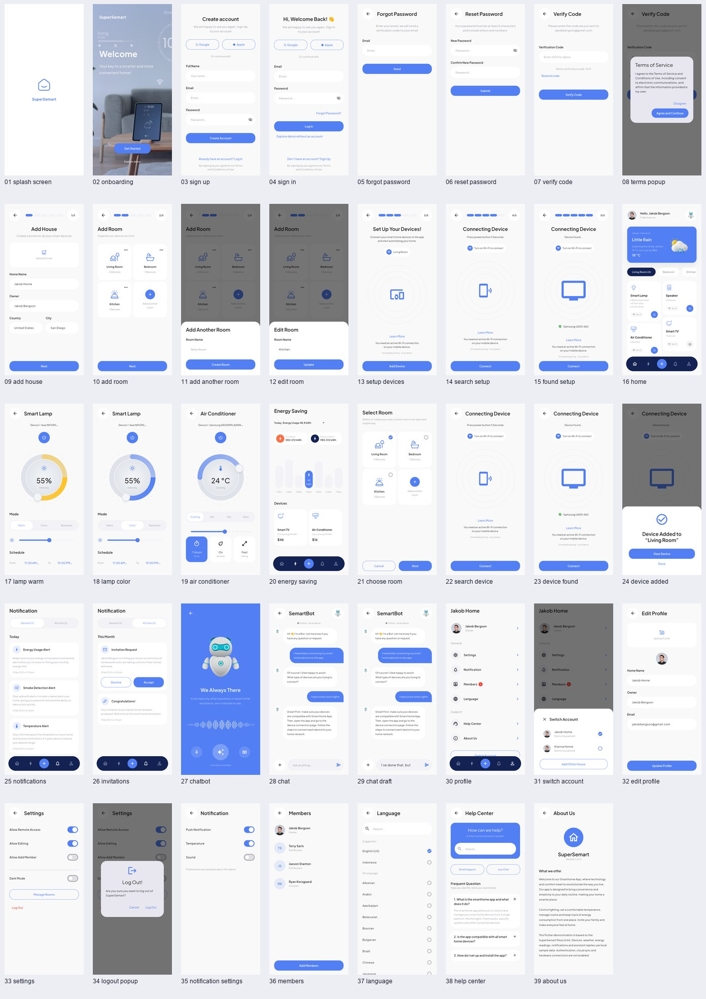
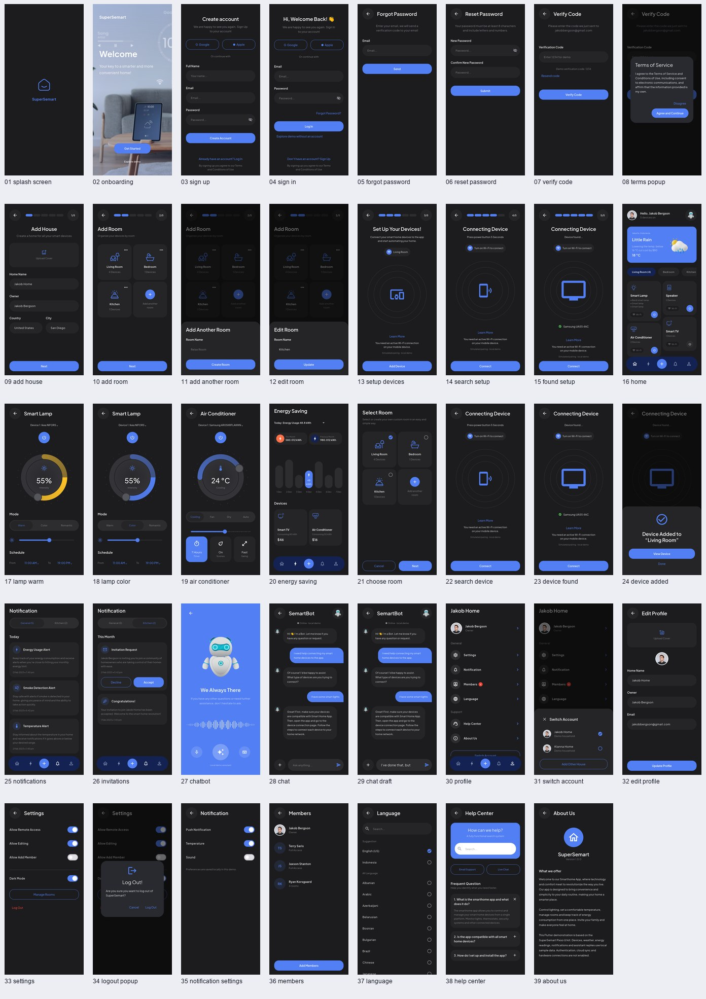

# 页面与截图索引

通过 Pixso MCP 读取文档 **SuperSemart - Smarthome Apps UI Kits**，遍历了 UI Design 全部顶层节点。Thumbnail 是展示封面，Style Guide 是色彩/排版/组件规范；UI Design 是应用界面，左右两组分别对应浅色/深色主题。

共有 **78 个手机画板 = 39 个浅色页面/状态 + 39 个深色页面/状态**，此外有 8 个分类标签和 2 个独立头像图层。设计尺寸为 390×844。分类标签和规范页没有当作 App 页面。重复的页面名称保留了步骤、弹窗与模式差异。

下表“原稿”是 Pixso 导出；“浅色/深色”是 Flutter 在已有 Android 模拟器上的实际截图，不能互相替代。

| 序号 | Pixso 页面 / 状态 | 浅色节点 ID | 实现路由或入口 | 原稿 | 浅色截图 | 深色截图 |
| --- | --- | --- | --- | --- | --- | --- |
| 1 | Splash Screen | `63:1590` | /splash | [查看](design/01_splash_screen.png) | [查看](screenshots/light/01_splash_screen.png) | [查看](screenshots/dark/01_splash_screen.png) |
| 2 | Onboarding | `63:1805` | /welcome | [查看](design/02_onboarding.png) | [查看](screenshots/light/02_onboarding.png) | [查看](screenshots/dark/02_onboarding.png) |
| 3 | Sign Up | `42:488` | /sign-up | [查看](design/03_sign_up.png) | [查看](screenshots/light/03_sign_up.png) | [查看](screenshots/dark/03_sign_up.png) |
| 4 | Sign In | `42:578` | /sign-in | [查看](design/04_sign_in.png) | [查看](screenshots/light/04_sign_in.png) | [查看](screenshots/dark/04_sign_in.png) |
| 5 | Forgot Password | `55:1513` | /forgot | [查看](design/05_forgot_password.png) | [查看](screenshots/light/05_forgot_password.png) | [查看](screenshots/dark/05_forgot_password.png) |
| 6 | Reset Password | `55:1596` | /reset | [查看](design/06_reset_password.png) | [查看](screenshots/light/06_reset_password.png) | [查看](screenshots/dark/06_reset_password.png) |
| 7 | Verify Code | `42:674` | /verify | [查看](design/07_verify_code.png) | [查看](screenshots/light/07_verify_code.png) | [查看](screenshots/dark/07_verify_code.png) |
| 8 | Pop Up | `42:784` | 验证码页 / 注册后的条款弹窗 | [查看](design/08_pop_up.png) | [查看](screenshots/light/08_terms_popup.png) | [查看](screenshots/dark/08_terms_popup.png) |
| 9 | Add House | `61:1462` | /add-house | [查看](design/09_add_house.png) | [查看](screenshots/light/09_add_house.png) | [查看](screenshots/dark/09_add_house.png) |
| 10 | Add Room | `62:1565` | /rooms | [查看](design/10_add_room.png) | [查看](screenshots/light/10_add_room.png) | [查看](screenshots/dark/10_add_room.png) |
| 11 | Add Another Room | `72:1206` | 房间页 → Add another room | [查看](design/11_add_another_room.png) | [查看](screenshots/light/11_add_another_room.png) | [查看](screenshots/dark/11_add_another_room.png) |
| 12 | Edit Room | `72:1302` | 房间页 → … | [查看](design/12_edit_room.png) | [查看](screenshots/light/12_edit_room.png) | [查看](screenshots/dark/12_edit_room.png) |
| 13 | Add Room | `63:1402` | /setup-device | [查看](design/13_add_room.png) | [查看](screenshots/light/13_setup_devices.png) | [查看](screenshots/dark/13_setup_devices.png) |
| 14 | Add Device (Search) | `63:1481` | /search-setup | [查看](design/14_add_device_search.png) | [查看](screenshots/light/14_search_setup.png) | [查看](screenshots/dark/14_search_setup.png) |
| 15 | Device Found | `63:1518` | /found-setup | [查看](design/15_device_found.png) | [查看](screenshots/light/15_found_setup.png) | [查看](screenshots/dark/15_found_setup.png) |
| 16 | Home | `8:196` | /home | [查看](design/16_home.png) | [查看](screenshots/light/16_home.png) | [查看](screenshots/dark/16_home.png) |
| 17 | Detail Lamp | `12:374` | /lamp | [查看](design/17_detail_lamp.png) | [查看](screenshots/light/17_lamp_warm.png) | [查看](screenshots/dark/17_lamp_warm.png) |
| 18 | Detail Lamp | `45:560` | /lamp → Color | [查看](design/18_detail_lamp.png) | [查看](screenshots/light/18_lamp_color.png) | [查看](screenshots/dark/18_lamp_color.png) |
| 19 | Detail Air Conditioner | `51:750` | /ac | [查看](design/19_detail_air_conditioner.png) | [查看](screenshots/light/19_air_conditioner.png) | [查看](screenshots/dark/19_air_conditioner.png) |
| 20 | Energy Saving | `30:77` | /energy | [查看](design/20_energy_saving.png) | [查看](screenshots/light/20_energy_saving.png) | [查看](screenshots/dark/20_energy_saving.png) |
| 21 | Choose Room | `44:345` | /choose-room | [查看](design/21_choose_room.png) | [查看](screenshots/light/21_choose_room.png) | [查看](screenshots/dark/21_choose_room.png) |
| 22 | Add Device (Search) | `37:94` | /search | [查看](design/22_add_device_search.png) | [查看](screenshots/light/22_search_device.png) | [查看](screenshots/dark/22_search_device.png) |
| 23 | Device Found | `38:1605` | /found | [查看](design/23_device_found.png) | [查看](screenshots/light/23_device_found.png) | [查看](screenshots/dark/23_device_found.png) |
| 24 | Device Added | `75:1384` | 发现页 → Connect | [查看](design/24_device_added.png) | [查看](screenshots/light/24_device_added.png) | [查看](screenshots/dark/24_device_added.png) |
| 25 | Notification (General) | `52:989` | /notifications | [查看](design/25_notification_general.png) | [查看](screenshots/light/25_notifications.png) | [查看](screenshots/dark/25_notifications.png) |
| 26 | Notification (General) | `53:832` | /invitations | [查看](design/26_notification_general.png) | [查看](screenshots/light/26_invitations.png) | [查看](screenshots/dark/26_invitations.png) |
| 27 | Chatbot | `97:4054` | /assistant | [查看](design/27_chatbot.png) | [查看](screenshots/light/27_chatbot.png) | [查看](screenshots/dark/27_chatbot.png) |
| 28 | Chat | `93:2232` | /chat | [查看](design/28_chat.png) | [查看](screenshots/light/28_chat.png) | [查看](screenshots/dark/28_chat.png) |
| 29 | Chat | `95:2793` | /chat-draft | [查看](design/29_chat.png) | [查看](screenshots/light/29_chat_draft.png) | [查看](screenshots/dark/29_chat_draft.png) |
| 30 | Profile | `93:1258` | /profile | [查看](design/30_profile.png) | [查看](screenshots/light/30_profile.png) | [查看](screenshots/dark/30_profile.png) |
| 31 | Switch Account | `93:1363` | 个人页 → Switch Account | [查看](design/31_switch_account.png) | [查看](screenshots/light/31_switch_account.png) | [查看](screenshots/dark/31_switch_account.png) |
| 32 | Edit Profile | `93:1482` | /edit-profile | [查看](design/32_edit_profile.png) | [查看](screenshots/light/32_edit_profile.png) | [查看](screenshots/dark/32_edit_profile.png) |
| 33 | Settings | `93:1508` | /settings | [查看](design/33_settings.png) | [查看](screenshots/light/33_settings.png) | [查看](screenshots/dark/33_settings.png) |
| 34 | Log Out | `93:1527` | 设置 → Log Out | [查看](design/34_log_out.png) | [查看](screenshots/light/34_logout_popup.png) | [查看](screenshots/dark/34_logout_popup.png) |
| 35 | Notification | `93:1555` | /notification-settings | [查看](design/35_notification.png) | [查看](screenshots/light/35_notification_settings.png) | [查看](screenshots/dark/35_notification_settings.png) |
| 36 | Members | `93:1573` | /members | [查看](design/36_members.png) | [查看](screenshots/light/36_members.png) | [查看](screenshots/dark/36_members.png) |
| 37 | Language | `93:1639` | /language | [查看](design/37_language.png) | [查看](screenshots/light/37_language.png) | [查看](screenshots/dark/37_language.png) |
| 38 | Help Center | `93:1782` | /help | [查看](design/38_help_center.png) | [查看](screenshots/light/38_help_center.png) | [查看](screenshots/dark/38_help_center.png) |
| 39 | About Us | `93:1827` | /about | [查看](design/39_about_us.png) | [查看](screenshots/light/39_about_us.png) | [查看](screenshots/dark/39_about_us.png) |

## 全部界面总览

### 浅色主题

### 深色主题

## 页面差异处理

- 注册、登录、找回密码、验证码和重置密码共用表单组件，保留各自验证和导航。
- 初始家庭配置的房间页与首页加号进入的选择房间页共用布局；原稿的第 3 步“Add Room”实际内容是设备设置准备页。
- 设备搜索/发现有初始配置和普通添加两种上下文，保留五步进度条的差异。
- 第 17/18 张是同一个灯光控制器的 Warm / Color 状态。
- 第 25/26 张是 General / Kitchen 通知分类。
- 第 28/29 张是聊天空输入框与已有草稿状态。实际软件键盘由系统弹出，不把原稿键盘栅格作为假控件。
- 第 8、11、12、24、31、34 张使用真实弹窗/底部面板，实现复用页面上的状态变化。
- 原稿中的 Lorem ipsum、拼写和品牌误植在必要处改为可理解的操作说明；真实功能边界见 README。

## 素材

机器人、头像、天气、欢迎背景及设备/房间图标直接从当前 Pixso 文件的具体图层导出，位于 `assets/images/`。Style Guide 的字体标签写作 General Sans，但实际文本图层 `fontName` 为 **Plus Jakarta Sans**，实现依据后者。

